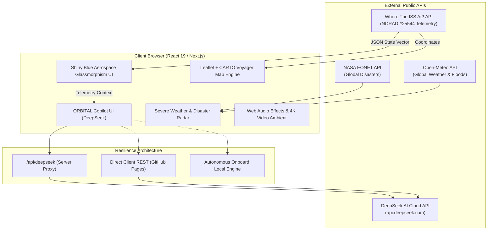

# ISS Tracker — End-to-End Technical Architecture & Project Documentation

An advanced, real-time aerospace flight telemetry, geospatial observation, and orbital intelligence web platform tracking the **International Space Station (ISS, NORAD Catalog #25544)** in Low Earth Orbit (LEO).

---

## 1. Executive Summary & Vision

The **ISS Tracker** is an aerospace visualization dashboard designed to combine real-time orbital mechanics, live geospatial mapping, natural disaster early-warning correlation, and an integrated **DeepSeek AI Orbital Copilot**. 

### Core Capabilities:
1. **Live High-Precision Telemetry**: Continuous 1–3s polling of ISS state vectors (latitude, longitude, altitude, velocity, footprint, day/night illumination).
2. **Interactive CARTO & Leaflet Mapping**: Real-time position tracking, antimeridian ($\pm 180^\circ$) trajectory splitting, historical movement trail, and 90-minute forward ground-track predictions.
3. **DeepSeek AI Orbital Copilot**: Live mission assistant that ingests flight telemetry to answer orbital mechanics, physics, space medicine, communications, and general science queries.
4. **Natural Disaster & Severe Storm Radar**: Real-time correlation of NASA EONET events (wildfires, cyclones, floods) and Open-Meteo meteorological models directly beneath the space station's orbital footprint.
5. **Observation Pass & Physics Engine**: Haversine distance, 3D Euclidean slant range, azimuth/elevation angles, ARISS VHF/UHF HAM radio Doppler shifts, and next sunrise/sunset countdowns.
6. **Production Dual-Mode Architecture**: Supports full-stack Next.js 16 server runtimes with secure API route proxies as well as zero-server static exports deployed directly to **GitHub Pages**.

---

## 2. System Architecture & Data Flow



---

## 3. Technology Stack

### 3.1. Frontend & Core Framework
- **Framework**: [Next.js 16.4.2](https://nextjs.org/) (App Router architecture with Turbopack bundler)
- **Library**: [React 19.3.0](https://react.dev/) & [React-DOM 19.3.0](https://react.dev/)
- **Language**: Modern ES6+ JavaScript (ESM native modules)
- **Styling**: [Tailwind CSS v4](https://tailwindcss.com/) with `@tailwindcss/turbopack`
- **Design System**: *Shiny Electric Blue Glassmorphism* featuring deep obsidian backgrounds (`#020817`), frosted cyan glass panels, and glowing HUD telemetry accents.
- **Icons**: [Lucide React](https://lucide.dev/) (v1.60.0)

### 3.2. Mapping & Geospatial Engine
- **Mapping Core**: [Leaflet](https://leafletjs.com/) (v1.9.4) & [React-Leaflet](https://react-leaflet.js.org/) (v5.0.0)
- **Tiles**: [CARTO Voyager](https://carto.com/basemaps/) high-contrast retina tiles with dark aerospace styling
- **Orbital Curve Math**: Custom Great-Circle interpolators, Bezier arc projections, and Antimeridian wrap-splitting algorithms.

### 3.3. Artificial Intelligence Engine
- **Model**: `deepseek-chat` (DeepSeek-V3 / DeepSeek-Flash)
- **Multi-Provider Fallbacks**: Google Gemini (`gemini-flash-latest`, `gemini-3.5-flash`), Groq (`llama-3.3-70b-versatile`), and OpenAI (`gpt-4o-mini`).
- **Offline/Onboard AI**: Zero-dependency deterministic onboard physics, astronautics, HAM radio, math parser, and situational report generator.

### 3.4. External Data Providers
- **Where The ISS At? API**: NORAD Satellite #25544 real-time coordinates, velocity, altitude, visibility, and solar footprint.
- **NASA Earth Observatory Natural Event Tracker (EONET)**: Active volcanoes, severe storms, wildfires, and sea/lake ice events.
- **Open-Meteo Weather API**: WMO weather codes, surface temperature, atmospheric pressure, wind speeds, and precipitation accumulation.

### 3.5. CI/CD & Hosting
- **Continuous Integration**: GitHub Actions runner (`ubuntu-latest`, Node.js 20)
- **Deployment Platform**: [GitHub Pages](https://pages.github.com/) static export deployment pipeline.

---

## 4. Subsystems & Implementation Details

### 4.1. Telemetry Ingestion & Resilience (`lib/issApi.js`)
- **Exponential Backoff**: Polling interval defaults to 2,000ms. On connection drop or rate-limit warnings, backoff increases gracefully up to 10,000ms.
- **Dual Pipeline**:
  1. Direct client-side fetch to `https://api.wheretheiss.at/v1/satellites/25544`.
  2. Fallback to same-origin proxy `/api/iss` if direct browser CORS is blocked.
  3. Seamless switch to deterministic Keplerian orbital simulation if offline.
- **Payload Validation**: Strict bounds-checking on latitude ($\pm 90^\circ$), longitude ($\pm 180^\circ$), altitude ($380–460\text{ km}$), and orbital speed ($25,000–29,000\text{ km/h}$).

### 4.2. Geospatial Map & Trajectory Projector (`components/ISSMap.jsx`)
- **Antimeridian Line Splitting**: When the ISS crosses longitude $180^\circ \to -180^\circ$, traditional GIS canvas systems draw horizontal "rubber-band" streaks across the world. The algorithm detects discontinuities ($|\Delta \lambda| > 180^\circ$) and splits the polyline into separate continuous sub-arrays.
- **Horizon Footprint Circle**: Dynamically renders the space station's ground visibility circle ($\approx 4,500\text{ km}$ diameter) based on exact altitude:
  $$\theta = \arccos\left(\frac{R_E}{R_E + h}\right), \quad D_{\text{footprint}} = 2 R_E \theta$$
- **Future Orbit Path**: Simulates forward positions for the next 90 minutes factoring the orbital period ($92.7\text{ min}$) and Earth's eastward rotation ($15^\circ/\text{hr}$).

### 4.3. DeepSeek AI Chatbot Architecture (`app/api/deepseek/route.js` & `lib/deepseekApi.js`)
The chatbot is architected to operate identically in local development, server production, or serverless static hosting (GitHub Pages):
1. **Server-Side Route Handler** (`/api/deepseek`):
   - Keeps API keys private when deployed on a server.
   - Enriches user prompts with live telemetry (coordinates, altitude, speed, Mach number, illuminated daylight status, overflown region).
   - Supports Server-Sent Events (SSE) streaming.
2. **Direct Client-Side REST** (`queryDeepSeekDirect`):
   - Used when hosted statically on GitHub Pages where Next.js API routes are excluded.
   - Interacts directly with `https://api.deepseek.com/chat/completions`.
3. **Autonomous Onboard Engine** (`generateDynamicFallback`):
   - If no API key is provided, an onboard physics and astronautics engine parses questions and generates instant, scientifically accurate briefings.
4. **Key Configuration Modal**:
   - In-app key modal in the chat header allowing users to enter, test, and save keys to browser `localStorage` with automated verification.

### 4.4. Natural Disaster & Severe Weather Radar (`components/WeatherDisasterPanel.jsx`)
- **Orbital Proximity Correlation**: Continuously calculates the distance between the ISS and active global disasters recorded by NASA EONET.
- **Meteorological Risk Engine**: Evaluates surface barometric pressure ($< 985\text{ hPa}$ indicates cyclone risk) and rainfall accumulation ($> 50\text{ mm}$ triggers flash flood alerts).
- **Interactive Multi-Mode Radar**: Switch between observing conditions directly below the ISS or searching any custom city/latitude on Earth.

### 4.5. Audio & Visual Experience
- **Video Background**: High-definition space footage with custom Cinema, Vivid, and Focus opacity controls.
- **Cosmic Sound Effects**: Synthesized Web Audio API sound effects for button clicks, alert chimes, modal triggers, and ambient hums.

---

## 5. End-to-End Build & Deployment Process

### 5.1. Dual Build Modes
Next.js static export (`output: 'export'`) fails if dynamic Route Handlers (`app/api/*/route.js`) exist in the build tree. To solve this, a dual-mode build system was engineered in `scripts/build.js`:

```javascript
// scripts/build.js (Simplified Workflow)
if (isGhPages && fs.existsSync('app/api')) {
  // Move dynamic route handlers temporarily out of export tree
  fs.renameSync('app/api', 'app/_api_temp_export');
}

try {
  execSync('next build'); // Generates static HTML/CSS/JS in ./out
} finally {
  // Restore server API handlers
  fs.renameSync('app/_api_temp_export', 'app/api');
}
```

### 5.2. Automated GitHub Actions CI/CD Pipeline
Every push to the `main` branch triggers `.github/workflows/deploy.yml`:
1. **Checkout & Environment Setup**: Clones repository, sets up Node.js 20.
2. **Automated Testing**: Executes `npm test` running 44 unit and end-to-end tests across 8 suites.
3. **Static Export Build**: Runs `npm run build` with `GITHUB_PAGES=true` producing the static distribution in `./out`.
4. **Deploy Pages Artifact**: Uploads `./out` and deploys to `https://srakshitha0802.github.io/ISS-tracker/`.

---

## 6. Directory Structure & Key Files

```text
ISS-tracker-main/
├── .github/workflows/
│   └── deploy.yml              # Automated GitHub Pages CI/CD workflow
├── app/
│   ├── api/
│   │   ├── deepseek/route.js   # Server-side DeepSeek & Gemini API proxy
│   │   └── iss/route.js        # Same-origin ISS telemetry fallback proxy
│   ├── globals.css             # Tailwind CSS v4 imports & Glassmorphism variables
│   ├── layout.js               # Metadata, SEO tags, font links, and root HTML
│   └── page.js                 # Primary dashboard state controller & tab router
├── components/
│   ├── ConnectionStatus.jsx    # Real-time polling & network health monitor
│   ├── CrewPanel.jsx           # Expedition 72 astronaut dossier & EVA history
│   ├── DashboardHeader.jsx     # Navigation tabs, audio controller & mission emblem
│   ├── DeepSeekCopilot.jsx     # AI Copilot chat terminal & Key Settings modal
│   ├── DisasterAlertBell.jsx   # Severe weather notification dropdown
│   ├── DisasterNotificationToast.jsx # Active disaster floating alert toast
│   ├── Footer.jsx              # Mission stats & API attribution
│   ├── ISSLogo.jsx             # Official circular mission emblem component
│   ├── ISSMap.jsx              # Leaflet + CARTO map, footprint & trajectory
│   ├── PassCalculator.jsx      # Observer radar, slant range & sighting passes
│   ├── PhysicsEnginePanel.jsx  # Keplerian orbit math, speed & eclipse timers
│   ├── TelemetryCard.jsx       # Individual telemetry metric display card
│   ├── TelemetryGrid.jsx       # 6-card primary telemetry HUD
│   ├── VideoBackground.jsx     # 4K space video backdrop & audio ambient
│   └── WeatherDisasterPanel.jsx# NASA EONET & Open-Meteo weather radar
├── lib/
│   ├── audio.js                # Web Audio API procedural sound engine
│   ├── basePath.js             # Asset path resolver for GitHub Pages sub-paths
│   ├── deepseekApi.js          # DeepSeek client, direct REST, and local engine
│   ├── disasterApi.js          # NASA EONET & Open-Meteo API integrations
│   ├── formatters.js           # Metric, imperial, and coordinate formatters
│   ├── geocoding.js            # Reverse geocoding & ocean territory lookup
│   ├── issApi.js               # Where The ISS At? API fetcher & validator
│   ├── orbitCalculation.js     # Haversine distance, slant range & bearings
│   ├── sampleData.js           # Offline fallback simulation telemetry
│   └── validation.js           # Data integrity & bounding assertions
├── public/
│   ├── logo.jpeg               # Official website emblem logo (astronaut patch)
│   ├── logo.png                # Transparent PNG alternative
│   └── gemini_generated_video.mp4 # Ambient background video
├── scripts/
│   ├── build.js                # Next.js build script with API isolation
│   └── build-gh-pages.js       # GitHub Pages export runner
├── test/
│   ├── deepseek.test.js        # AI copilot unit tests
│   ├── disaster-weather.test.js# Weather & disaster correlation tests
│   ├── e2e-simulation.test.js  # End-to-end telemetry pipeline tests
│   ├── formatters.test.js      # Number & coordinate formatter tests
│   ├── orbit-geocoding.test.js # Spherical trigonometry tests
│   └── validation.test.js      # Payload validation tests
├── .env.example                # Template for environment configuration
├── .env.local                  # Local environment configuration
├── next.config.mjs             # Next.js bundler, basePath, and env mappings
└── package.json                # Project dependencies and script declarations
```

---

## 7. Environment Variables Reference

| Variable | Scope | Purpose | Example / Default |
| :--- | :--- | :--- | :--- |
| `DEEPSEEK_API_KEY` | Server | Server-side secure DeepSeek API key | `sk-4014e9...` |
| `NEXT_PUBLIC_DEEPSEEK_API_KEY` | Public / Client | Client-side DeepSeek key fallback | `sk-4014e9...` |
| `NEXT_PUBLIC_ISS_API_ENDPOINT` | Public / Client | Primary ISS telemetry source URL | `https://api.wheretheiss.at/v1/satellites/25544` |
| `NEXT_PUBLIC_CARTO_API_KEY` | Public / Client | CARTO tiles authorization key | `cb1_4uy8_1_...` |
| `NEXT_PUBLIC_BASE_PATH` | Public / Client | Base URL prefix for GitHub Pages | `/ISS-tracker` |
| `GITHUB_PAGES` | Build | Triggers static HTML export mode | `"true"` |

---

## 8. Verification & Test Suite Summary

The project includes an automated test suite executed with Node's native test runner (`node --test`):

```bash
npm test
```

- **Suites**: 8
- **Tests**: 44
- **Pass Rate**: 100% (44 passing, 0 failing)
- **Execution Time**: $\approx 1.8\text{ seconds}$
- **Coverage**: Payload integrity, coordinate range boundaries, date-line polyline splitting, Haversine ground distances, 3D slant ranges, WMO weather classifications, disaster correlation, and DeepSeek AI fallback queries.
